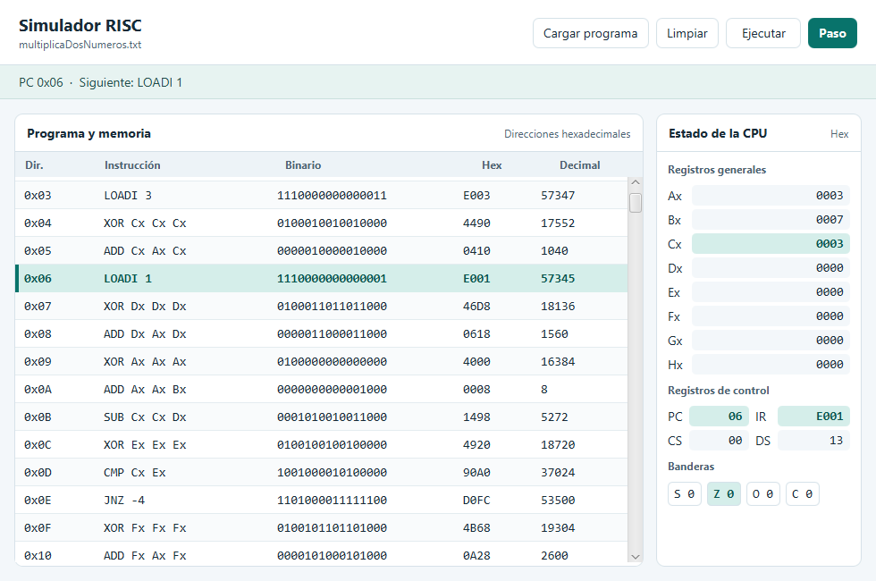

# RISC Architecture Simulator

This is a simulator for a custom RISC (Reduced Instruction Set Computing) architecture, built using Java and JavaFX for the graphical user interface. The simulator models the basic operations of a simple RISC processor, allowing you to perform and visualize operations like arithmetic, logical, memory access, and branching instructions.

## Features

- **ALU Operations**: 
  - Addition (`ADD`)
  - Subtraction (`SUB`)
  - Logical AND (`AND`)
  - Logical OR (`OR`)
  - Logical XOR (`XOR`)
  - Logical NOT (`NOT`)
  - Comparison (`CMP`)

- **Memory Operations**:
  - Load (`LOAD`)
  - Store (`STORE`)

- **Branching Instructions**:
  - Jump (`JUMP`)
  - Conditional Jump (Zero - `JZ`, Non-Zero - `JNZ`)

- **Shift Operations**:
  - Shift Left (`SHL`)
  - Shift Right (`SHR`)

- **Program Counter Management**: 
  - The simulator tracks the program counter and updates it after every instruction execution.

## Setup

Install JDK 22 and point `JAVA_HOME` to it. Clone the repository and open its directory.

```bash
git clone https://github.com/MauricioART/RISC-Architecture-Simulator.git
cd RISC-Architecture-Simulator
```

On Windows, launch the simulator with the Maven Wrapper.

```powershell
.\mvnw.cmd javafx:run
```

On macOS or Linux, run `sh ./mvnw javafx:run`. If Maven is already installed, use `mvn javafx:run` on any platform. The first run needs network access to download any missing build dependencies.

## Using the debugger



1. Select **Cargar programa** to open an assembly text file. Try `ProgramExamples/multiplicaDosNumeros.txt`. Loading a program starts a new simulation.
2. Select **Paso** to execute one instruction. The status bar shows the program counter and the next instruction. The memory table follows that instruction and shows each word in binary, hexadecimal, and decimal.
3. Check **Estado de la CPU** for the general-purpose registers, control registers, and flags. Values that changed during the last step are highlighted. Hover over a hexadecimal register value to see its binary and decimal forms.
4. Select **Ejecutar** to run continuously or **Pausar** to inspect the current state and resume later. If execution triggers a code segment violation, the status bar shows the error and leaves the CPU and memory visible for inspection.
5. Select **Limpiar** to unload the program and reset the CPU and memory.

## Instruction reference

### ALU Methods

- **add**: Adds two registers and stores the result in a destination register.
- **sub**: Subtracts the second register from the first and stores the result.
- **and**: Performs a bitwise AND on two registers and stores the result.
- **or**: Performs a bitwise OR on two registers and stores the result.
- **xor**: Performs a bitwise XOR on two registers and stores the result.
- **not**: Performs a bitwise NOT on a register.
- **cmp**: Compares two registers (used for conditional branching).

### Memory and Branching Methods

- **load**: Loads a value from memory into a register.
- **store**: Stores a value from a register into memory.
- **jump**: Jump to a specific memory address.
- **jz**: Conditional jump if the Zero flag is set.
- **jnz**: Conditional jump if the Zero flag is not set.

### Shift Operations

- **shiftLeft**: Performs a left shift on a register value.
- **shiftRight**: Performs a right shift on a register value.
- **load12Bit**: Loads a 12-bit value into a register.

## Contributing

Feel free to fork the repository and make improvements! If you find any bugs or have ideas for enhancements, please open an issue or submit a pull request.

## License

This project is open-source and available under the [MIT License](LICENSE).

## Contact

If you have any questions or suggestions, you can reach out to the project owner:

- **Mauricio A. Aguilera Roa**
- GitHub: [MauricioART](https://github.com/MauricioART)
